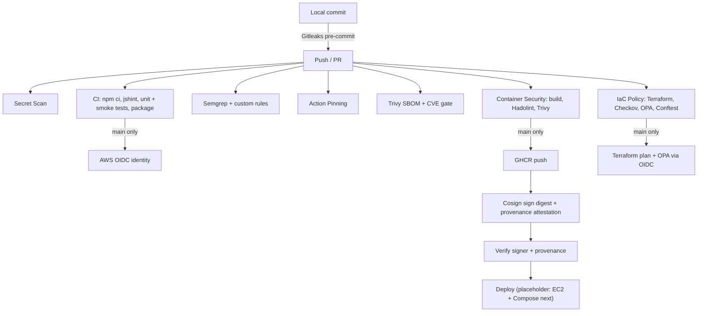

# NodeGoat DevSecOps Pipeline

Final project for CAPS-CS.5023.01 (Ronald Montgomery). [OWASP NodeGoat](https://github.com/OWASP/NodeGoat), an intentionally vulnerable Node.js/Express + MongoDB app, is built, scanned, hardened, signed and policy-checked by GitHub Actions. The goal, from my midterm checkpoint, is to fix every confirmed vulnerability before release, not just to report them.

The controls were first built and validated on a small app in [RonaldMontgomery/my-app](https://github.com/RonaldMontgomery/my-app) (Labs 3–6, 8 and 10) and in my private Lab 7 repository. This repository recreates them for NodeGoat. NodeGoat-specific changes are called out below. The original NodeGoat README is in [docs/NODEGOAT-UPSTREAM-README.md](docs/NODEGOAT-UPSTREAM-README.md).

- **Status and divergences from the midterm plan:** [docs/draft-pipeline-review.md](docs/draft-pipeline-review.md)
- **Upstream base:** OWASP/NodeGoat @ `c5cb68a` (Apache-2.0), imported as the first commit. Each later commit corresponds to one lab.

---

## Pipeline at a glance

| Workflow | Lab | What it enforces | Blocks on |
|---|---|---|---|
| `secret-scan.yml` | 2 | Gitleaks over the pushed commit range (full history checked out) | Any detected secret |
| `ci.yml` | 3 | `npm ci`, upstream jshint, unit tests, smoke test against seeded MongoDB, packaged artifact, AWS OIDC identity check on `main` | Install, lint or test failure |
| `sast.yml` | 4 | `semgrep --test` on custom rules, then `--config auto` + custom rules with `--error` | Any Semgrep finding |
| `action-pinning.yml` | 4 | Rejects `@main`, `@master`, `@vN` action references | Any floating reference |
| `sca.yml` | 5 | Trivy CycloneDX SBOM (artifact) + `trivy fs` | Any CRITICAL dependency CVE |
| `container-security.yml` | 6, 10 | Hadolint, Trivy image gate; on `main`: GHCR push, Cosign keyless sign, build-provenance attestation, separate verify job | Hadolint finding, CRITICAL image CVE, failed signature/provenance verification |
| `iac-policy.yml` | 7, 8 | Terraform fmt/validate, Checkov, OPA tests, Conftest on Compose and Kubernetes manifests; on `main`: Terraform plan + OPA plan evaluation via OIDC | Checkov failure, policy deny, failing policy test |
| Dependabot | 5 | Weekly npm, GitHub Actions and Docker base-image PRs with a 7-day cooldown | Normal checks apply |



Every workflow defaults to `permissions: contents: read`. Elevated permissions are granted per job: `id-token: write` only on the main-branch AWS and signing jobs, and `packages: write` / `attestations: write` only on `publish-sign`. Pull requests never receive cloud credentials or publish anything (threat T1). All third-party actions are pinned to full commit SHAs and use the same reviewed pins as my-app.

---

## Lab 2: secrets

Gitleaks 8.30.0 found three secrets in upstream NodeGoat:

| Finding | Location | Action |
|---|---|---|
| `private-key` | `artifacts/cert/server.key` | Deleted; `*.key`/`*.pem` ignored; [regeneration instructions](artifacts/cert/README.md) |
| `generic-api-key` (ZAP API key) | `config/env/development.js`, `config/env/test.js` | Read from `ZAP_API_KEY` |

Gitleaks did not flag the hard-coded `cookieSecret` and `cryptoKey` in `config/env/all.js`, but they were remediated too, and a custom Semgrep rule now catches that pattern:

- `SESSION_SECRET` and `CRYPTO_KEY` come from the environment. In production a missing value **stops startup**. In development and test, each process gets a random value, so no shared default exists.
- The startup config dump (`config/config.js`) now redacts secret values (threat T4: keep secrets out of logs).
- History was rewritten **before first publication** with the Lab 2 method, so the key and the ZAP key literal are absent from every commit. A full-history scan (`gitleaks git . --log-opts="--all"`) reports no leaks.
- `.pre-commit-config.yaml` runs Gitleaks before each commit (`pre-commit install`). `secret-scan.yml` repeats the check in CI in case the hook is skipped.
- `.env.example` documents the variables. `.env` is git-ignored. AWS Secrets Manager for the EC2 host is planned.

## Lab 3: CI

`build-test` runs on every push and on PRs to `main`, with a disposable `mongo:4.4` service container:

1. `npm ci` (Cypress binary download skipped; it is an unused upstream e2e dependency)
2. `npx jshint .` (upstream lint config; replaces upstream's unpinned `lint.yml`)
3. `npm run test:unit`: Node built-in test runner, 5 tests covering the Lab 2 secret handling ([test/ci/config.test.js](test/ci/config.test.js))
4. [scripts/smoke-test.sh](scripts/smoke-test.sh): seeds MongoDB, starts the app in production mode with throwaway secrets, checks `GET /login` returns 200, checks anonymous requests to `/dashboard`, `/profile`, `/contributions`, `/memos` redirect to `/login`, and checks the session secret never appears in the app log
5. Package `app.tar.gz` (excludes `.git`, `.github`, `node_modules`, env files, `.npmrc`) and upload it as `app-<sha>`, retained for 14 days

`aws-oidc` runs on `main` only, after `build-test`, and only once the `AWS_ROLE_ARN` repository variable is set (the IAM trust policy must first name this repository's OIDC subject). It prints the token subject/audience and runs `aws sts get-caller-identity`. No long-lived AWS keys exist.

Upstream's `e2e-test.yml` (Cypress on Node 10–14) and `lint.yml` were removed. Both used unpinned `@v1`/`@v2` actions that the pinning check rejects.

## Lab 4: SAST

`semgrep --config auto --config .semgrep/custom-rules.yml --error .` is a blocking gate. Before it, `semgrep --test .semgrep/` checks each custom rule against positive (`ruleid:`) and negative (`ok:`) cases in [.semgrep/custom-rules.js](.semgrep/custom-rules.js).

| Custom rule | Origin | Purpose |
|---|---|---|
| `no-child-process-exec` | my-app | Shell execution with possible command injection |
| `express-session-hardcoded-secret` | Midterm plan (T4) | String-literal `secret`, `cookieSecret`, `sessionSecret`, `cryptoKey` |
| `eval-of-request-input` | New (NodeGoat A1) | Taint rule: `req.body`/`query`/`params` reaching `eval`, `new Function`, `setTimeout(string)` |

`eval-of-request-input` targets the server-side JavaScript injection in `app/routes/contributions.js`. It is fixed: the three `eval(req.body.*)` calls now use `parseInt(value, 10)`. The rule's positive test case keeps it from regressing silently.

`.semgrepignore` restates Semgrep's defaults and excludes the rule fixtures and vendored minified browser libraries in `app/assets/vendor/`. Those libraries are a known gap; see the review doc.

**Expected state:** the default ruleset flags NodeGoat's remaining intentional vulnerabilities, so this gate fails until they are triaged and fixed. That matches the midterm policy: unreviewed findings block.

## Lab 5: SCA and SBOM

`sca.yml` matches my-app: Trivy v0.74.0 is installed from a commit-pinned install script, generates a CycloneDX SBOM (`sbom.json`, uploaded as an artifact, includes dev dependencies), and fails on any CRITICAL vulnerability. Dependabot proposes weekly updates for npm, GitHub Actions and, new here, Docker base images.

**Expected state:** NodeGoat's dependency set dates from 2016 (`marked 0.3.5`, `mongodb 2.x`, `swig`, `bcrypt-nodejs`, …), so this gate fails until those are upgraded or replaced.

## Lab 6: container security

| Upstream | This repo |
|---|---|
| `node:12-alpine` (EOL), copies the entire repo, `npm install` | `node:22-bookworm-slim` deps stage with `npm ci --omit=dev --ignore-scripts`; `gcr.io/distroless/nodejs22-debian12:nonroot` runtime |
| Named user `node` | Numeric `USER 65532` (avoids Hadolint DL3066, as in my-app) |
| No `CMD`; dev defaults | `NODE_ENV=production`, so missing secrets stop the container |
| Whole build context | Explicit `COPY` of `server.js`, `app/`, `config/`, `artifacts/db-reset.js`; `.dockerignore` drops tests, infra, policy, CI, secrets |

Hadolint 2.14.0 reports no findings on this Dockerfile.

Node 22 is used here instead of my-app's Node 24. Node 23 removed the long-deprecated `util.is*` helpers, which NodeGoat's 2016-era dependencies may still call. Node 22 is LTS through April 2027. I'll revisit after the dependency upgrades.

`docker-compose.yml` is hardened for the EC2 target:

- MongoDB is on an `internal: true` network with no published port.
- The app binds to `127.0.0.1:4000` only (reach it over an SSM tunnel).
- App containers: UID 65532, `read_only`, `cap_drop: [ALL]`, `no-new-privileges`, CPU/memory limits.
- Distroless has no shell, so upstream's `sh -c "until nc …"` loop is replaced by a MongoDB healthcheck and a one-shot `seed` service.
- Secrets come from `.env`, and Compose refuses to start without them.

`container-security.yml` is my-app's workflow with the image renamed. On `main` (or a manual run) the `publish-sign` job rebuilds and rescans the image, pushes `ghcr.io/<owner>/<repo>:<sha>`, resolves the immutable digest, signs it with Cosign keyless (GitHub OIDC), and attaches a GitHub build-provenance attestation. A separate `verify` job checks `gh attestation verify --signer-workflow` and `cosign verify` against the exact workflow identity on `refs/heads/main` before the placeholder `deploy` job.

A non-blocking Trivy report for `mongo:4.4` was added. 4.4 is end-of-life, but the mongodb 2.x driver can't talk to a supported server yet.

**Expected state:** the image includes NodeGoat's production dependencies, so the Critical gate is expected to fail, and publishing and signing are skipped until the dependency work lands.

## Lab 7: infrastructure and policy as code

- `infra/`: S3 bucket for pipeline evidence (scan reports, SBOMs, provenance; threat T8), with the Lab 7 baseline: public access blocked, `BucketOwnerEnforced`, versioning, `aws:kms` with bucket key, lifecycle cleanup, `Project`/`Owner` default tags. Three Checkov skips are documented inline (access logging, cross-region replication, event notifications), as in Lab 7.
- `infra/policy.rego`: every S3 bucket create/update needs a nonempty `Project` tag, set directly or through `default_tags`. Covered by 5 OPA unit tests.
- `policy/compose/compose.rego`: the midterm gate-4 rules for Compose: no privileged containers, no host networking, no published database ports, ports bound to loopback only, no Docker socket mounts, and app services must be read-only, drop ALL capabilities, set `no-new-privileges` and run as non-root. Covered by 6 tests. Upstream's compose file fails 5 of these rules.
- `iac-policy.yml`: `static` job (fmt, validate, Checkov, `opa test`, checksum-verified Conftest, `conftest verify`/`test`) on PRs and `main`. The `plan` job (Terraform plan, `terraform show -json`, `opa eval --fail-defined`) runs only on `main`, once `AWS_PLAN_ROLE_ARN` is set.

As in Lab 7, CI never runs `apply` or `destroy`. Provisioning is a manual, local step.

## Lab 8: Kubernetes

Manifests for the local kind cluster, in `k8s/`:

- `namespace.yaml`: Restricted Pod Security (enforce, audit, warn), pinned to v1.34.
- `deployment.yaml`, `seed-job.yaml`, `mongo.yaml`: non-root, seccomp `RuntimeDefault`, `allowPrivilegeEscalation: false`, drop ALL, read-only root filesystem, CPU/memory limits, no service-account token, ClusterIP services only.
- `policy.yaml`: Kyverno `require-resource-limits` from my-app, scoped to `nodegoat`. `deployment-invalid.yaml` is the known-bad case.
- `policy/k8s/k8s.rego`: the same rules checked in CI before anything reaches a cluster (6 tests). CI also asserts the invalid manifest is rejected.

Local runbook (kind + Kyverno already installed, as in Lab 8):

```bash
docker build -t nodegoat:local .
kind load docker-image nodegoat:local --name lab8
kubectl apply -f k8s/namespace.yaml
kubectl -n nodegoat create secret generic nodegoat-secrets \
  --from-literal=SESSION_SECRET="$(openssl rand -hex 32)" \
  --from-literal=CRYPTO_KEY="$(openssl rand -hex 32)"
kubectl apply -f k8s/policy.yaml -f k8s/mongo.yaml
kubectl -n nodegoat rollout status deploy/mongo
kubectl apply -f k8s/seed-job.yaml && kubectl -n nodegoat wait --for=condition=complete job/nodegoat-seed --timeout=120s
kubectl apply -f k8s/deployment.yaml
kubectl -n nodegoat port-forward svc/nodegoat 4000:4000
# Negative test: Kyverno should reject this
kubectl apply -f k8s/deployment-invalid.yaml
```

---

## Running locally

```bash
cp .env.example .env        # fill in SESSION_SECRET and CRYPTO_KEY
docker compose up --build   # http://127.0.0.1:4000  (seed users: see docs/NODEGOAT-UPSTREAM-README.md)
pre-commit install          # Gitleaks hook
```

## Repository settings to apply after the first push

1. **Branch protection on `main`:** require PRs and the status checks `build-test`, `Semgrep SAST`, `Enforce Action SHA Pins`, `Gitleaks`, `sca` and `container-security`. Block bypass, including for administrators. Under the solo-student exception, approvals are not required.
2. **Variables** (Settings → Secrets and variables → Actions → Variables): set `AWS_ROLE_ARN` and `AWS_PLAN_ROLE_ARN`. The first `aws-oidc` run prints this repository's exact OIDC subject before it tries to assume the role. In Lab 3 that subject included numeric owner and repository IDs. Add it to the IAM trust policies, then re-run.
3. **Packages:** after the first publish, confirm the GHCR package is linked to this repository.

## Evidence

- [evidence/policy-tests-local.txt](evidence/policy-tests-local.txt): OPA and Conftest unit tests, the hardened manifests passing, and the upstream compose file and invalid deployment being rejected (run locally with OPA 1.10.1 / Conftest 0.62.0)
- GitHub Actions run history for everything else

## AI use disclosure

I used Claude to port the controls from my-app and Lab 7 to NodeGoat, write the new policies, tests and documentation, and run the locally available checks (Gitleaks, Hadolint, OPA, Conftest, Node unit tests). Semgrep, Trivy, Terraform, Checkov and Docker builds could not run in that environment; their first results come from GitHub Actions.
