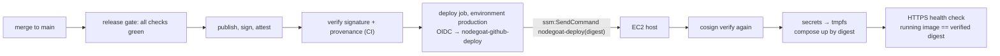

# EC2 deployment

The signed image runs with Docker Compose on one EC2 host in `us-east-1`. The host
has no SSH key and no inbound rules; it is reached only through AWS Systems Manager.



## Controls

| Control | Where |
|---|---|
| Only a digest that passed every gate and was signed on `main` is deployed | `container-security.yml`: `release-gate` → `publish-sign` → `verify` → `deploy` |
| The host verifies the Cosign signature itself before running anything | `scripts/deploy-host.sh` |
| GitHub can run one SSM document, with one parameter (`^sha256:[a-f0-9]{64}$`), on one instance | `infra/deploy.tf`: `aws_ssm_document.deploy`, `aws_iam_role_policy.github_deploy` |
| The deploy role trusts only this repository's `production` environment (by numeric owner and repository IDs) | `infra/deploy.tf`: `aws_iam_role.github_deploy` |
| No long-lived AWS keys in GitHub; no credentials in pull request jobs | OIDC; job runs only after `publish-sign`, which runs only on `main` |
| No inbound traffic, no SSH key | security group with egress 80/443 only; OPA `terraform.ec2` policy |
| IMDSv2 with hop limit 1, so containers cannot reach instance credentials (defence in depth behind the SSRF fix) | `metadata_options`; OPA `terraform.ec2` policy |
| Secrets read at deploy time from Secrets Manager, written only to tmpfs (`/run/nodegoat`), gone on reboot | `scripts/deploy-host.sh`; host role can read only `nodegoat/*` |
| Encrypted root volume; Ubuntu unattended security upgrades (on by default) | `infra/deploy.tf` |

## Secrets (created once in CloudShell; values never leave AWS)

| Secret | Used as |
|---|---|
| `nodegoat/session-secret` | `SESSION_SECRET` |
| `nodegoat/crypto-key` | `CRYPTO_KEY`, which encrypts SSN/DOB/bank fields at rest. Do not rotate without re-encrypting stored data. |
| `nodegoat/tls` | `{"key": ..., "cert": ...}`, self-signed for `localhost` (reached through the SSM tunnel) |

## Provision (CloudShell, as an administrator)

```bash
git clone https://github.com/RonaldMontgomery/nodegoat-devsecops.git
cd nodegoat-devsecops/infra
terraform init
terraform apply -var "cosign_sha256=<sha256 of cosign-linux-amd64>"
terraform output
```

Then in GitHub, **Settings → Secrets and variables → Actions → Variables**:

| Variable | Value |
|---|---|
| `AWS_DEPLOY_ROLE_ARN` | `terraform output -raw github_deploy_role_arn` |
| `DEPLOY_INSTANCE_ID` | `terraform output -raw app_instance_id` |

and **Settings → Environments → production → Deployment branches and tags → Selected: `main`**.

## Operate

- **Deploy:** merge to `main` (or re-run the `Deploy to EC2` job). If the host is stopped, the job warns and skips.
- **Open the app** (Session Manager plugin installed locally):
  `aws ssm start-session --region us-east-1 --target <instance-id> --document-name AWS-StartPortForwardingSession --parameters portNumber=4000,localPortNumber=4000`
  then browse to `https://localhost:4000` (self-signed certificate warning expected).
- **Cost:** `t3.small` + 16 GB gp3. Stop the instance when not in use:
  `aws ec2 stop-instances --region us-east-1 --instance-ids <instance-id>`. After a start, re-run the deploy job (secrets live on tmpfs).
- **Tear down after grading:** `terraform destroy`, then delete the three `nodegoat/*` secrets.
